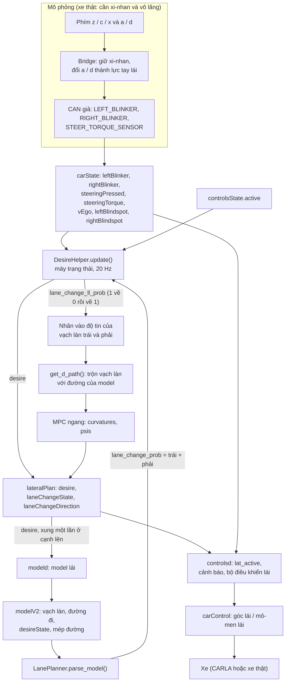
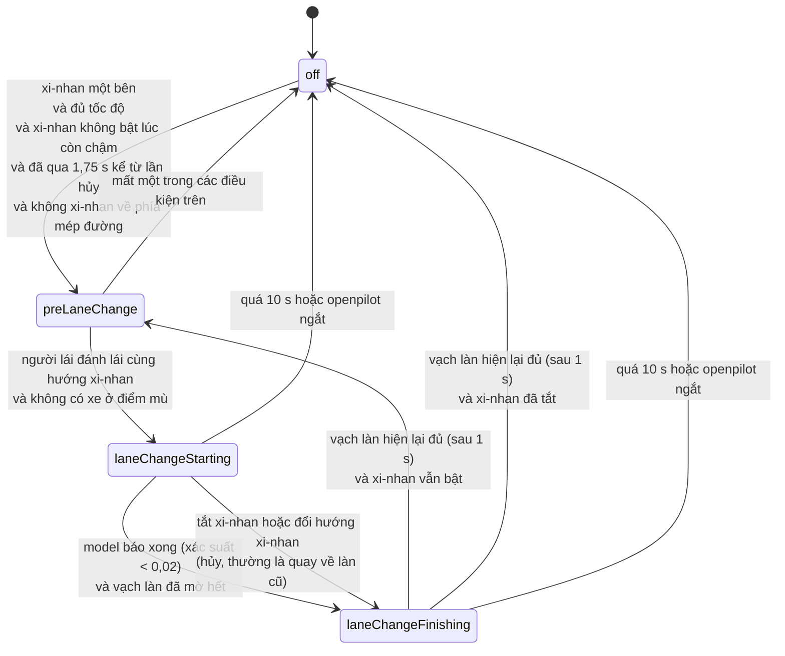
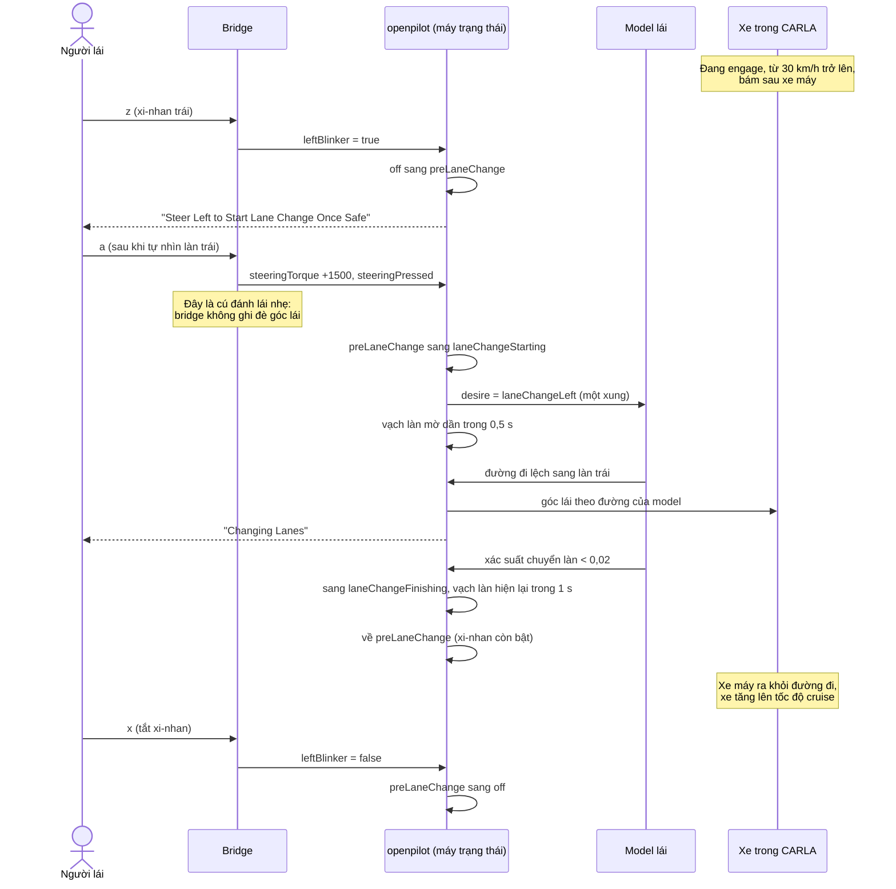

# Cơ chế chuyển làn hiện tại (Assisted Lane Change, ALC)

Ngày viết: 2026-11-12. Nhánh `bukapilot-motorcycle`, gồm cả các thay đổi chưa commit trong `tools/sim`.
Tài liệu mô tả code đang có, không đề xuất thay đổi.

## Tóm tắt

- Xe **không tự quyết định** chuyển làn. Người lái phải làm hai việc: bật xi-nhan, rồi đánh lái nhẹ cùng hướng. Sau đó openpilot tự lái sang làn bên.
- Phần "lái sang làn" do **model lái** thực hiện. Code điều khiển chỉ gửi cho model một tín hiệu ý định (`desire`), rồi tạm bỏ qua vạch làn để đi theo đường mà model vẽ ra.
- Toàn bộ logic nằm trong một máy trạng thái bốn bước ở `selfdrive/controls/lib/desire_helper.py`: `off`, `preLaneChange`, `laneChangeStarting`, `laneChangeFinishing`.
- Điều khiển dọc (ga, phanh) **không biết gì** về chuyển làn. Xe vẫn bám xe trước ở khoảng cách bình thường cho tới khi xe đó ra khỏi đường đi.
- Trong mô phỏng CARLA: `z` / `c` bật xi-nhan trái / phải, `a` / `d` là cú đánh lái nhẹ, `x` tắt xi-nhan. Ngưỡng tốc độ là 30 km/h (xe thật: 30 mph, khoảng 48,3 km/h). Mô phỏng không có cảm biến điểm mù.

## Các thành phần tham gia

| Thành phần | File | Vai trò trong chuyển làn |
|---|---|---|
| Máy trạng thái | `selfdrive/controls/lib/desire_helper.py` | Quyết định trạng thái, hướng, và `desire` gửi cho model |
| Lateral planner | `selfdrive/controls/lib/lateral_planner.py` | Gọi máy trạng thái mỗi 50 ms, làm mờ vạch làn, chạy MPC ngang, phát `lateralPlan` |
| Lane planner | `selfdrive/controls/lib/lane_planner.py` | Đọc vạch làn và xác suất "đang chuyển làn" từ model, trộn vạch làn với đường của model |
| Model | `selfdrive/modeld/modeld.cc`, `models/driving.cc` | Nhận `desire`, vẽ đường đi sang làn bên, báo lại `desireState` |
| controlsd | `selfdrive/controls/controlsd.py` (dòng 487 đến 571) | Bật hoặc tắt lái ngang khi có xi-nhan, hiện cảnh báo |
| Cảnh báo | `selfdrive/controls/lib/events.py` (dòng 479 đến 517) | Nội dung các thông báo |
| Bridge mô phỏng | `tools/sim/bridge/common.py`, `tools/sim/lib/keyboard_ctrl.py`, `tools/sim/lib/simulated_car.py` | Biến phím bấm thành xi-nhan và lực tay lái trên CAN giả |

## Luồng dữ liệu

Có một vòng kín đáng chú ý: máy trạng thái gửi `desire` cho model, model đổi đường đi và báo lại xác suất "đang chuyển làn" (`desireState`), rồi chính xác suất này cho máy trạng thái biết khi nào đã chuyển xong.

## Máy trạng thái

### Điều kiện chung

Mỗi chu kỳ, trước khi xét trạng thái, code kiểm tra `ready_for_lane_change` (`desire_helper.py:100`). Nếu sai, trạng thái về `off` ngay. Điều kiện gồm:

- openpilot đang engage (`controlsState.active`);
- tính năng ALC được bật (tham số `IsAlcEnabled`, mặc định bật);
- lần chuyển làn hiện tại chưa kéo dài quá 10 s (`LANE_CHANGE_TIME_MAX`);
- xe không báo tắt hỗ trợ giữ làn (`lkaDisabled`).

### Từng trạng thái

**`off`: chờ.** Chuyển sang `preLaneChange` khi đủ cả các điều kiện sau (`desire_helper.py:124-130`):

- đúng một xi-nhan đang bật;
- tốc độ từ `LANE_CHANGE_SPEED_MIN` trở lên;
- xi-nhan **không** được bật lúc xe còn dưới ngưỡng tốc độ. Nếu bật xi-nhan khi còn chậm rồi mới tăng tốc, ALC vẫn không chạy; phải tắt xi-nhan rồi bật lại;
- đã qua 1,75 s kể từ lần hủy gần nhất (`ALC_CANCEL_DELAY`);
- không xi-nhan về phía mép đường. Hàm `is_road_edge_blinker` coi bên đó là mép đường khi model thấy mép đường khá chắc (độ tin trên 0,475) và gần như không thấy vạch làn ngoài cùng bên đó (dưới 0,2).

**`preLaneChange`: chờ người lái xác nhận.** Hướng chuyển làn được đặt theo xi-nhan. Màn hình hiện "Steer Left / Right to Start Lane Change Once Safe". Chưa gửi `desire` nào cho model, xe vẫn giữ làn bình thường.

- Người lái đánh lái cùng hướng (`steeringPressed` và dấu mô-men đúng hướng: dương là trái, âm là phải) và không có xe ở điểm mù bên đó: sang `laneChangeStarting`.
- Có xe ở điểm mù: ở lại trạng thái này, hiện "Car Detected in Blindspot".
- Mất điều kiện bắt đầu (tắt xi-nhan, tụt dưới ngưỡng tốc độ): về `off`.

**`laneChangeStarting`: đang sang làn.**

- `desire` = `laneChangeLeft` hoặc `laneChangeRight`. Model chỉ nhận tín hiệu này như một xung ở chu kỳ đầu tiên (`driving.cc:59-67`), sau đó tự nhớ.
- `lane_change_ll_prob` giảm từ 1 về 0 trong 0,5 s. Lateral planner nhân giá trị này vào độ tin của hai vạch làn (`lateral_planner.py:55-57`). Vạch làn hết trọng số, đường đi mong muốn trở thành đúng đường của model, tức là đường sang làn bên.
- Màn hình hiện "Changing Lanes".
- Khi model báo tổng xác suất chuyển làn dưới 0,02 và vạch làn đã mờ hết: sang `laneChangeFinishing`.
- Trạng thái này **không** kiểm tra lại tốc độ hay điểm mù. Đã bắt đầu thì chỉ dừng khi xong, khi bị hủy bằng xi-nhan, khi quá 10 s, hoặc khi openpilot ngắt.

**`laneChangeFinishing`: ổn định ở làn mới.**

- `desire` vẫn giữ hướng chuyển làn.
- `lane_change_ll_prob` tăng từ 0 về 1 trong 1 s, vạch làn (của làn mới) dần có trọng số trở lại.
- Khi đạt trên 0,99: hướng về `none`. Nếu xi-nhan vẫn bật và còn đủ điều kiện thì về `preLaneChange`, tức là một cú đánh lái nữa sẽ chuyển tiếp một làn. Nếu không thì về `off`.

### Hủy giữa chừng

Khi đang ở `laneChangeStarting` mà người lái tắt xi-nhan hoặc bật xi-nhan ngược lại (`desire_helper.py:112-121`):

- Nếu model đã gần như chắc là chuyển xong (xác suất dưới 0,25 và vạch làn đã mờ hết): giữ hướng, kết thúc ở làn mới.
- Nếu chưa: **đảo hướng** chuyển làn. `desire` đổi sang hướng ngược lại, model nhận một xung mới và đưa xe về làn cũ.
- Cả hai trường hợp đều sang `laneChangeFinishing` và ghi thời điểm hủy. Trong 1,75 s sau đó không bắt đầu được lần chuyển làn mới.

## Vai trò của controlsd

controlsd không chạy máy trạng thái. Nó tính lại riêng điều kiện tốc độ và xi-nhan (`controlsd.py:492-521`) để quyết định hai việc.

**Bật hay tắt lái ngang (`lat_active`, dòng 548).** Lái ngang bị tắt khi xi-nhan bật mà ALC không hoạt động (`is_alc_active` sai). Trường hợp điển hình là xi-nhan bật dưới ngưỡng tốc độ: openpilot buông lái, hiện "Steer Manually / Turn Signal on Below Assisted Lane Change Speed", người lái tự rẽ. Ga và phanh vẫn do openpilot giữ.

`is_alc_active` đúng khi openpilot engage, ALC được bật, và một trong hai điều sau:

- xe đủ tốc độ và xi-nhan không được bật lúc còn chậm;
- hoặc xe vừa tụt xuống dưới ngưỡng **trong khi** đang chuyển làn (cờ `alc_speed_below`). Nhờ vậy openpilot không buông lái giữa chừng nếu xe chậm lại lúc đang sang làn.

**Hiện cảnh báo (dòng 524-535 và 570-571).**

| Tình huống | Thông báo |
|---|---|
| Xi-nhan bật, có xe ở điểm mù bên đó | Car Detected in Blindspot |
| Trạng thái `preLaneChange` | Steer Left / Right to Start Lane Change Once Safe |
| Trạng thái `laneChangeStarting` hoặc `laneChangeFinishing` | Changing Lanes |
| Xi-nhan bật nhưng lái ngang đang tắt (thường do dưới ngưỡng tốc độ) | Steer Manually, Turn Signal on Below Assisted Lane Change Speed |

Sau khi lái ngang được bật lại, lực lái bị giảm trong 2 s đầu (`reduce_steer`, dòng 582-584) để không giật vô lăng.

## Điều khiển dọc trong lúc chuyển làn

Không có code nào nối chuyển làn với bộ lập kế hoạch dọc. Hệ quả:

- Bật xi-nhan không làm xe giảm tốc hay mở khoảng cách. Người lái tự mở khoảng cách nếu cần (hạ tốc độ cruise).
- Trong lúc sang làn, xe vẫn bám xe trước ở khoảng cách bình thường. Chỉ khi xe trước ra khỏi đường đi của xe mình (model không còn coi nó là lead) thì xe mới tăng lên tốc độ cruise.
- Muốn vượt được thì tốc độ cruise phải cao hơn tốc độ xe trước.

Phần tự mở khoảng cách (`ALC_GAP_TF`) từng được viết rồi bị gỡ ngày 2026-11-12, vì tự giảm tốc có thể nguy hiểm cho xe phía sau. Xem `plans/261111-1450-carla-window-input-and-lane-change-assist/plan.md`, mục Session 5.

## Riêng cho mô phỏng CARLA

### Phím bấm thành tín hiệu xe

| Phím | Lệnh | Kết quả trên xe giả |
|---|---|---|
| `z` | `blinker_left` | Xi-nhan trái bật và **được giữ** |
| `c` | `blinker_right` | Xi-nhan phải bật và được giữ |
| `x` | `blinker_off` | Tắt xi-nhan. Đây là cách duy nhất để tắt, ngoài reset (`r`) |
| `a` | `steer_-0.15` | Mô-men tay lái +1500 (trái), vượt ngưỡng `steeringPressed` là 1200 |
| `d` | `steer_0.15` | Mô-men tay lái -1500 (phải) |

Mô-men được gửi qua tín hiệu CAN `STEER_TORQUE_SENSOR` nên openpilot thấy nó giống như trên xe Honda thật. Một lần bấm phím có tác dụng trong 0,25 s (`MANUAL_TIMEOUT`).

### Đánh lái nhẹ hay lái tay

Bình thường phím `a` / `d` là lái tay: bridge bỏ lệnh lái của openpilot và tự đặt góc vô lăng. Như vậy openpilot sẽ không bao giờ tự chuyển làn được. Hàm `plan_manual_routing` (`bridge/common.py:52-64`) xử lý việc này:

Phím lái chỉ là **cú đánh lái nhẹ** (mô-men vẫn gửi lên CAN, nhưng góc lái của xe vẫn do openpilot điều khiển) khi đủ cả ba điều kiện:

- openpilot đang engage;
- `laneChangeState` khác `off` (tức là máy trạng thái đang ở `preLaneChange` hoặc đang chuyển làn);
- phím cùng hướng với xi-nhan đang giữ.

Mọi trường hợp khác, phím lái vẫn là lái tay như cũ. Vì vậy người dùng luôn giành lại được vô lăng: bấm ngược hướng xi-nhan, hoặc tắt xi-nhan rồi bấm.

### Trình tự một lần vượt xe máy

### Khác biệt so với xe thật

| Mục | Xe thật | Mô phỏng |
|---|---|---|
| Ngưỡng tốc độ | 30 mph (khoảng 48,3 km/h) | 30 km/h, đặt bằng biến môi trường `ALC_MIN_SPEED_KPH` trong `start_docker.sh`. Không đặt biến thì code dùng 30 mph |
| Điểm mù | Có trên xe hỗ trợ BSM | Không có. Người dùng tự nhìn làn bên |
| Xi-nhan | Cần xi-nhan, tự nhả sau khi trả lái | Giữ cho tới khi bấm `x` |
| Đánh lái | Lực tay thật trên vô lăng | Phím `a` / `d` tạo mô-men cố định 1500 |

Logic chuyển làn trong `selfdrive/` là chung cho cả hai. Khác biệt duy nhất trong `selfdrive/` là ngưỡng tốc độ đọc từ biến môi trường.

## Các hằng số

| Hằng số | Giá trị | Nơi định nghĩa |
|---|---|---|
| `LANE_CHANGE_SPEED_MIN` | 30 mph, hoặc `ALC_MIN_SPEED_KPH` km/h | `desire_helper.py:26` |
| `LANE_CHANGE_TIME_MAX` | 10 s | `desire_helper.py:27` |
| `ALC_CANCEL_DELAY` | 1,75 s | `desire_helper.py:28` |
| Thời gian làm mờ vạch làn | 0,5 s | `desire_helper.py:149` |
| Thời gian hiện lại vạch làn | 1 s | `desire_helper.py:158` |
| Ngưỡng model báo xong | xác suất < 0,02 | `desire_helper.py:152` |
| Ngưỡng giữ làn mới khi hủy | xác suất < 0,25 | `desire_helper.py:117` |
| Ngưỡng mép đường | 0,475 | `desire_helper.py:64` |
| Chu kỳ máy trạng thái | 50 ms (`DT_MDL`) | `common/realtime.py:14` |
| Mô-men phím lái trong mô phỏng | 0,15 x 10000 = 1500 | `bridge/common.py:214` |
| Ngưỡng `steeringPressed` (Honda) | 1200 | `selfdrive/car/honda/carstate.py:256` |

## Giới hạn hiện tại

- Không tự vượt: không có xi-nhan và cú đánh lái của người lái thì không bao giờ chuyển làn.
- Không kiểm tra làn đích có trống không, ngoài cảm biến điểm mù của xe. Trong mô phỏng không có cảm biến này, nên xe sẽ chuyển làn kể cả khi có xe ở làn bên.
- Điểm mù chỉ được xét ở `preLaneChange`. Xe xuất hiện ở điểm mù sau khi đã bắt đầu thì không dừng được lần chuyển làn.
- Không mở khoảng cách và không tăng tốc trước khi sang làn. Nếu đang bám sát xe trước thì xe sang làn ở đúng khoảng cách đó.
- Xi-nhan còn bật sau khi chuyển xong thì trạng thái về `preLaneChange`, một lần bấm `a` / `d` nữa sẽ chuyển thêm một làn. Trong mô phỏng phải bấm `x` để tắt.
- Bật xi-nhan lúc xe còn dưới ngưỡng tốc độ thì openpilot buông lái ngang, và ALC không chạy kể cả khi sau đó xe đủ tốc độ, cho tới khi tắt rồi bật lại xi-nhan.
- Xe đứng sau vật đứng yên thì dừng hẳn, dưới mọi ngưỡng tốc độ, nên không dùng ALC để tránh được.
- Lần chạy đầy đủ trong CARLA (xi-nhan, đánh lái, vượt xe máy) chưa có báo cáo đo. Các kiểm tra tới nay là unit test và chạy offline máy trạng thái thật (plan nêu trên, Session 5).
