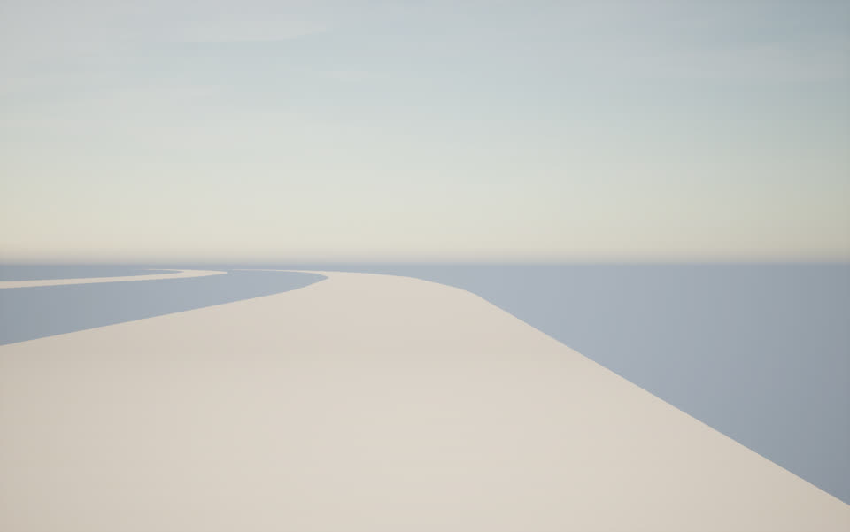
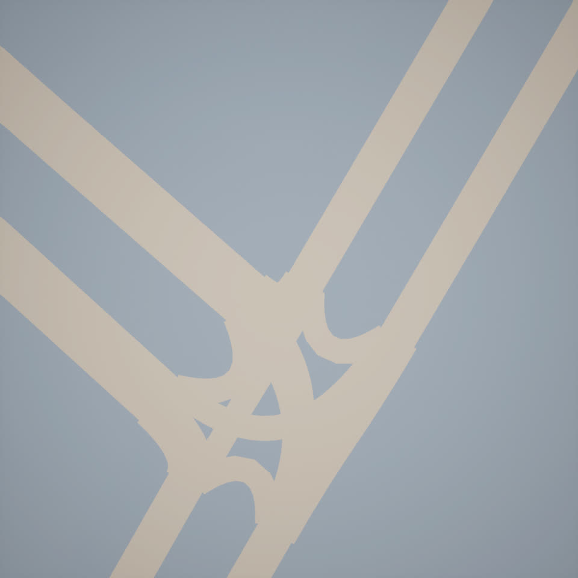

# Nghiên cứu: clone đường Khu CNC Hòa Lạc từ OpenStreetMap vào CARLA

Ngày: 2026-11-13. Mọi số đo dưới đây được chạy trên máy văn phòng (Ubuntu 26.04, RTX 5060 Ti 16 GB, 16 nhân, 29 GB RAM, còn trống 283 GB), trong container tạm, không đụng tới `carla_server` và `bukapilot_sim_carla` đang chạy.

## 1. Vị trí

- OSM có ranh giới khu: relation `19849694` "Khu Công nghệ cao Hòa Lạc", tâm 21.0112 N, 105.5362 E, khung bao 20.9907 đến 21.0313 N, 105.5189 đến 105.5559 E (khoảng 4,5 x 4 km).
- Hà Nội cho Phenikaa-X thử nghiệm có kiểm soát xe tự hành 24 tháng tại khu này: robotaxi và robot giao hàng chạy trên mạng đường khoảng 11,5 km, tốc độ dự kiến không quá 40 km/h, khung giờ 9:00 đến 16:30. Báo chí và trang của Ban quản lý không công bố tên đường của tuyến.
- OSM không có sân thử riêng (không có `highway=raceway` hay khu thử xe) trong khung bao. "Khu đường chạy thử" vì vậy là đường nội khu thông thường.
- Phạm vi đã chốt với người dùng: lưới trục N ở lõi khu, khung 105.5270 đến 105.5450 E, 21.0030 đến 21.0190 N (khoảng 1,9 x 1,8 km), gồm N07, N09, N11, N12, N13, N14, N16.

## 2. Chất lượng dữ liệu OSM (đo trên bản tải ngày 2026-11-13)

| Chỉ số | Toàn khu | Lõi lưới N |
|---|---|---|
| Đường chạy xe được | 188,2 km | 39,6 km (tertiary 23,1 km, service 14,4 km) |
| Có thẻ `lanes` (theo chiều dài) | 39,6 % | 59,6 % |
| Có thẻ `oneway` | 31,3 % | 50,2 % |
| Có thẻ `maxspeed` | 30,9 % | 36,9 % |
| Có thẻ `width` | 0 | 0 |
| Đèn tín hiệu | 4 | 0 |
| Nhà (`building`) | 556 | chưa đếm riêng |
| Cao độ | không có | không có |

Kết luận: hình dạng tim đường và số làn của các trục N đủ dùng. Thiếu bề rộng làn, vạch kẻ, cao độ; đường `service` gần như không có thẻ. Các trục N được vẽ thành hai chiều tách rời (`oneway=yes`, 2 đến 3 làn mỗi chiều).

## 3. Thử nghiệm OSM sang OpenDRIVE sang CARLA 0.9.12 (đã chạy thật)

- `carla.Osm2Odr` có sẵn trong client `carla==0.9.12` của image `bukapilot-sim:local`. Chuyển đổi không cần server.
- Toàn khu: 4453 road, 469 junction, 0,5 giây. Lõi lưới N: 209 road, 26 junction, 0,1 giây.
- File OpenDRIVE có khai báo vạch (`solid` 212, `broken` 123 ở lõi) nhưng cao độ toàn bộ bằng 0 và bề rộng làn mặc định 4,0 m.
- `client.generate_opendrive_world()` trên một server 0.9.12 tạm (cổng 2100, off-screen): 1,4 giây, 370 điểm spawn, xe Tesla Model 3 spawn và đứng được trên mặt đường.
- Hình ảnh: mặt đường là một dải phẳng màu be, **không có vạch kẻ làn, không có nền đất, nhà, cây**. Nút giao của đường hai chiều tách rời sinh ra mesh chồng chéo.

Kết luận: luồng OSM sang OpenDRIVE sang standalone khả thi ngay, không cần cài gì, nhưng chỉ cho hình học. Model camera của bukapilot không có vạch để bám nên không dùng được để đánh giá lái.

Script đã dùng: `probe-osm-crop.py`, `probe-osm-to-xodr.py`, `probe-standalone-render.py` trong thư mục này.

## 4. Các hướng dựng map có vạch

| Hướng | Cần gì | Ưu | Nhược |
|---|---|---|---|
| Standalone OpenDRIVE trên 0.9.12 | không gì thêm | xong trong vài giây | không vạch, không cảnh vật |
| Digital Twin Tool, CARLA 0.9.15 | build CARLA và Unreal 4.26 từ source (khoảng 130 GB, 4 giờ trở lên), tài khoản Epic liên kết GitHub | tự sinh đường có vạch, nhà theo footprint OSM, cây; khoảng 10 phút cho 2 x 2 km, lưu map một đến vài giờ | CARLA ghi rõ là tính năng thử nghiệm, có thể còn vùng chưa trang trí; phải đổi sim sang 0.9.15 |
| Giữ 0.9.12, sinh mesh bằng script rồi `make import` | build CARLA 0.9.12 từ source, tự viết bộ sinh mesh | không đổi bridge, giữ baseline | phải tự viết và bảo trì bộ sinh mesh |
| Nhập map vào bản đóng gói bằng Docker của CARLA | 600 đến 700 GB đĩa | không cần editor | máy chỉ còn 283 GB, loại |

Người dùng chốt: thử swap sang 0.9.15 trước, nếu khả thi thì chuyển hẳn rồi dựng map bằng Digital Twin Tool.

## 5. Điều kiện để swap sang 0.9.15

- PyPI có wheel `carla==0.9.15` cho Python 3.8 (cp38). Bản 0.9.16 chỉ có cp310 đến cp312, nên bukapilot (Python 3.8) không dùng được 0.9.16.
- Docker Hub có `carlasim/carla:0.9.15` (8,9 GB nén).
- Thay đổi giữa 0.9.12 và 0.9.15 có thể ảnh hưởng sim: gamma camera về 2,2 thay vì 2,4 (0.9.15); cảm biến va chạm chỉ phát một sự kiện mỗi frame (0.9.15); điểm spawn tự sinh hạ từ 3 m xuống 0,5 m (0.9.14); nhiều sửa đổi Traffic Manager (0.9.13 đến 0.9.15). `demo.md` đã ghi nhận chỉ số điểm spawn khác nhau giữa các bản CARLA.
- Chỗ đang ghim 0.9.12 trong repo: `tools/sim-linux-docker/Dockerfile.bukapilot:40`, `Dockerfile.carla:6`, `start_carla.sh:23,28`, `run.sh:44,46`, `carla-assets/build_rider_logo.py:33` (asset đã cook cho 0.9.12), và nhánh Windows/WSL `tools/sim/run.sh:103`, `tools/sim/run.ps1:22`.
- Build từ source 0.9.15: tài liệu nhắm Ubuntu 18.04 và 20.04 (clang-8 hoặc clang-10). Máy đang chạy Ubuntu 26.04 nên cần build trong container Ubuntu 20.04.

## Nguồn

- [Hanoi allows 24-month trial of autonomous vehicles at Hoa Lac (VietnamPlus)](https://en.vietnamplus.vn/hanoi-allows-24-month-trial-of-autonomous-vehicles-at-hoa-lac-post350907.vnp)
- [Xe buýt tự hành, robotaxi, robot giao hàng được vận hành thử nghiệm ở Hà Nội (VietnamPlus)](https://www.vietnamplus.vn/xe-buyt-tu-hanh-robotaxi-robot-giao-hang-duoc-van-hanh-thu-nghiem-o-ha-noi-post1132845.vnp)
- [Hà Nội chính thức cho phép thử nghiệm xe buýt tự hành, robotaxi (Ban quản lý Khu CNC Hòa Lạc)](http://www.hhtp.gov.vn/vi/tin-tuc/ha-noi-chinh-thuc-cho-phep-thu-nghiem-xe-buyt-tu-hanh-robotaxi-2858.html)
- [Chính thức thử nghiệm có kiểm soát xe tự hành (Báo Văn Hóa)](https://baovanhoa.vn/xe/chinh-thuc-thu-nghiem-co-kiem-soat-xe-tu-hanh-264052.html)
- [CARLA 0.9.12: Generate maps with OpenStreetMap](https://carla.readthedocs.io/en/0.9.12/tuto_G_openstreetmap/)
- [CARLA 0.9.12: OpenDRIVE standalone mode](https://carla.readthedocs.io/en/0.9.12/adv_opendrive/)
- [CARLA 0.9.12: Custom map overview](https://carla.readthedocs.io/en/0.9.12/tuto_M_custom_map_overview/)
- [CARLA 0.9.12: Ingest a map in a CARLA package](https://carla.readthedocs.io/en/0.9.12/tuto_M_add_map_package/)
- [CARLA 0.9.15: Digital Twin Tool](https://carla.readthedocs.io/en/0.9.15/adv_digital_twin/)
- [CARLA 0.9.15: Linux build](https://carla.readthedocs.io/en/0.9.15/build_linux/)
- [CARLA 0.9.15 CHANGELOG](https://raw.githubusercontent.com/carla-simulator/carla/0.9.15/CHANGELOG.md)
- Dữ liệu bản đồ: © OpenStreetMap contributors, giấy phép ODbL.
